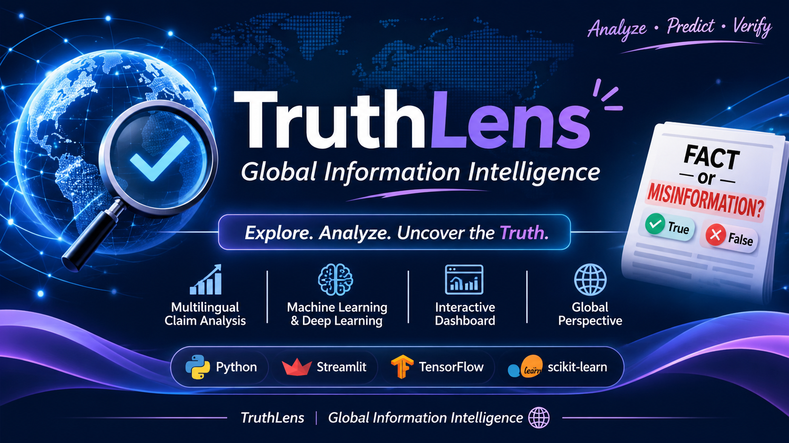

# 🔎 TruthLens

## Global Information Intelligence

**TruthLens** is a multilingual claim classification project that explores how Machine Learning and Deep Learning models classify online claims into fact-checking categories.

The project combines Natural Language Processing (NLP), text preprocessing, feature engineering, model training, evaluation, and an interactive Streamlit dashboard.

> **Important Notice:** TruthLens provides experimental machine learning classifications. Its predictions do not establish whether a claim is factually true or false. Always consult reliable evidence and independent fact-checking sources.

---

## 📌 Project Overview

The goal of TruthLens is to explore multilingual claim classification using different Machine Learning and Deep Learning approaches and compare their performance.

### Key Features

- Dataset exploration and preprocessing
- Exploratory Data Analysis (EDA)
- Natural Language Processing (NLP)
- Text feature engineering
- Machine Learning classification
- Deep Learning with Bidirectional LSTM
- Model evaluation and error analysis
- Interactive Streamlit dashboard
- Three-model prediction comparison

---

## 📂 Dataset

TruthLens uses the **X-FACT dataset**.

| Dataset Information | Details |
|---|---|
| Total Records | 19,079 |
| Original Columns | 17 |
| Languages | 13 |
| Classification Categories | 7 |

**Languages:** Portuguese, Indonesian, Arabic, Georgian, Polish, Tamil, Spanish, Italian, Turkish, Hindi, German, Romanian, and Serbian.

**Dataset Source:** [X-FACT Dataset on Hugging Face](https://huggingface.co/datasets/utahnlp/x-fact)

**Dataset Note:** The original dataset is not included in this GitHub repository because of its file size. Download it from the source above and place the training CSV file at `data/xfact_train.csv` before running the notebooks.

---

## 🏷️ Classification Categories

1. False
2. Partly true / misleading
3. True
4. Mostly true
5. Mostly false
6. Complicated / hard to categorise
7. Other

---

## 🛠️ Technologies Used

| Area | Technologies |
|---|---|
| Programming | Python |
| Data Analysis | Pandas, NumPy |
| Visualization | Matplotlib, Seaborn, Plotly |
| Machine Learning | Scikit-learn |
| Deep Learning | TensorFlow, Keras |
| NLP | TF-IDF, Character-level Tokenization |
| Dashboard | Streamlit |
| Model Storage | Joblib, Pickle, Keras |
| Development | VS Code, Jupyter Notebook |
| Environment | Conda |

---

## 🤖 Machine Learning Models

- Logistic Regression
- Linear Support Vector Classifier (LinearSVC)
- Tuned LinearSVC using GridSearchCV

### Machine Learning Results

| Model | Accuracy | Balanced Accuracy | Macro F1 |
|---|---:|---:|---:|
| Logistic Regression | 36.92% | 44.75% | 32.24% |
| LinearSVC | 43.40% | 38.34% | 36.14% |
| Tuned LinearSVC | 43.74% | 44.62% | 36.58% |

**Best Macro F1:** Tuned LinearSVC — 36.58%.

---

## 🧠 Deep Learning Models

Two Bidirectional LSTM experiments were developed:

- Original Bidirectional LSTM
- Class-Weighted Bidirectional LSTM

### Deep Learning Results

| Model | Accuracy | Balanced Accuracy | Macro F1 |
|---|---:|---:|---:|
| Original Bidirectional LSTM | 45.05% | 25.63% | 24.46% |
| Class-Weighted Bidirectional LSTM | 27.02% | 40.92% | 25.70% |

Class weighting improved balanced accuracy and Macro F1, but reduced overall accuracy.

---

## 📊 Model Comparison Dashboard

TruthLens includes an interactive Streamlit dashboard that compares predictions from three models:

1. Original Bidirectional LSTM
2. Class-Weighted Bidirectional LSTM
3. Tuned LinearSVC

Users can enter a claim and view predictions from all three models together.

---

## 🗂️ Project Structure

```text
TruthLens/
│
├── dashboard/
│   └── app.py
│
├── models/
│   └── Saved Models and Preprocessing Artifacts
│
├── notebooks/
│   ├── 01_dataset_loading.ipynb
│   ├── 02_nlp_feature_engineering.ipynb
│   ├── 03_machine_learning.ipynb
│   └── 04_deep_learning.ipynb
│
├── reports/
│   ├── eda_findings.md
│   ├── ml_evaluation.md
│   ├── deep_learning_evaluation.md
│   └── deep_learning_metrics.csv
│
├── README.md
├── requirements.txt
└── .gitignore
```

---

## ⚙️ Installation & Setup

### 1. Clone the Repository

```bash
git clone https://github.com/afifatima52-blip/TruthLens.git
```

### 2. Open the Project Directory

```bash
cd TruthLens
```

### 3. Create a Conda Environment

```bash
conda create -n truthlens_env python=3.11
```

### 4. Activate the Environment

```bash
conda activate truthlens_env
```

### 5. Install Dependencies

```bash
pip install -r requirements.txt
```

### 6. Download the Dataset

Download the X-FACT dataset from Hugging Face and place the training CSV file inside the `data/` directory using this filename:

`xfact_train.csv`

### 7. Run the Streamlit Dashboard

```bash
python -m streamlit run dashboard/app.py
```

---

## 📑 Project Reports

Detailed project findings and evaluation reports are available in the `reports/` directory:

- **EDA Findings:** Dataset exploration and analysis.
- **Machine Learning Evaluation:** ML model performance and comparisons.
- **Deep Learning Evaluation:** Bidirectional LSTM experiments and results.
- **Deep Learning Metrics:** Model evaluation metrics in
